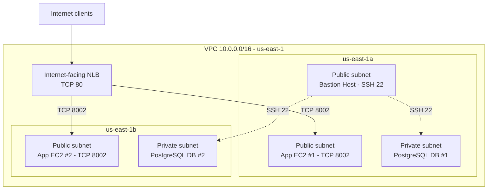

# AWS Multi-AZ Web Application with Network Load Balancing

A documented AWS training lab that deployed a small Python HTTP application on two Ubuntu EC2 instances in separate Availability Zones, placed both instances behind an internet-facing Network Load Balancer, and configured a private PostgreSQL tier reachable through a Bastion Host.

The focus was on **VPC networking, EC2 provisioning, Linux service automation, traffic distribution, and operational validation**. The original AWS resources have since been deleted; this repository preserves evidence from the completed lab, not a continuously hosted application.

> **Scope:** The screenshots show two healthy application targets in different Availability Zones. They do not demonstrate automated instance replacement, an intentional failover test, database replication, or an end-to-end app-to-database connection.

## Objectives

- Build an AWS VPC with public and private networking across two Availability Zones.
- Configure routing, a NAT Gateway, Security Groups, and network ACLs.
- Use an EC2 Launch Template and User Data to configure the same HTTP service on two Ubuntu instances.
- Distribute TCP traffic with a Network Load Balancer and verify healthy targets.
- Keep PostgreSQL hosts in private subnets and access them through a Bastion Host.
- Configure a CloudWatch CPU alarm and troubleshoot infrastructure connectivity.

## Architecture



The lab used an Internet Gateway for the public subnets and **one NAT Gateway in AZ1** for private-subnet outbound routing. The application instances were in **public subnets**, as required by the assignment; PostgreSQL instances were in **private subnets**. The databases were configured as independent lab hosts, not a replicated database cluster.

### Network layout

| Subnet | Availability Zone | IPv4 CIDR | Deployed role |
| --- | --- | --- | --- |
| `ha-webapp-public-az1` | `us-east-1a` | `10.0.1.0/24` | App 1 and Bastion Host |
| `ha-webapp-private-az1` | `us-east-1a` | `10.0.2.0/24` | PostgreSQL DB 1 |
| `ha-webapp-public-az2` | `us-east-1b` | `10.0.3.0/24` | App 2 |
| `ha-webapp-private-az2` | `us-east-1b` | `10.0.4.0/24` | PostgreSQL DB 2 |

### Access and traffic

| Flow | Protocol/port | Documented control |
| --- | --- | --- |
| Internet → Network Load Balancer | TCP `80` | NLB Security Group |
| NLB → application targets | TCP `8002` | Application Security Group allowed NLB SG |
| Administrator → Bastion | TCP `22` | Administrative public IPv4 `/32` |
| Bastion → app and DB hosts | TCP `22` | Security Group source references |
| PostgreSQL local access | TCP `5432` on loopback | DB validation showed `127.0.0.1:5432` |

Custom public/private NACLs were also present. The screenshots show some broad `allow all traffic` rules after SSH-specific restrictions, so the NACL configuration should not be described as strictly least-privilege on every port.

## Technologies

AWS VPC, EC2, Launch Templates, EC2 User Data, Internet Gateway, NAT Gateway, route tables, Security Groups, network ACLs, Bastion Host, Network Load Balancer, target groups, CloudWatch, AWS CLI, Ubuntu Linux, Bash, Python 3, `systemd`, SSH, PostgreSQL, `curl`, `ss`, `systemctl`, and `tcpdump`.

## Repository contents

```text
.
├── .gitignore
├── README.md
├── docs/
│   ├── REVIEW_BEFORE_PUBLISH.md
│   ├── evidence-and-limitations.md
│   └── troubleshooting.md
├── scripts/
│   └── user-data.sh
└── screenshots/
    ├── app1-service-validation.jpg
    ├── app2-service-validation.jpg
    ├── cloudwatch-cpu-alarm.jpg
    ├── nlb-healthy-targets.jpg
    ├── postgresql-db1-query.jpg
    ├── ssh-to-private-db1.jpg
    └── subnets-across-azs.jpg
```

The original course PDF and the author's submission report are not included. The full report contains AWS account/network identifiers and public IP/DNS information in embedded screenshots. Only selected evidence images are included here; they still contain historical internal addresses and AWS resource IDs.

## Implementation summary

The following describes the **completed lab**, not a one-command redeployment process:

1. Created `ha-webapp-vpc` with CIDR `10.0.0.0/16`, then created four subnets across `us-east-1a` and `us-east-1b`.
2. Configured public routing through an Internet Gateway and private outbound routing through a NAT Gateway in AZ1.
3. Created separate Security Groups for the Bastion, NLB, app servers, and databases; configured public and private network ACLs.
4. Launched the Bastion Host in a public subnet with SSH restricted to an administrative source address.
5. Defined `ha-webapp-app-lt` (launch template version 1) with User Data that installed Python 3, wrote a demonstration HTTP server, and registered `bashar-srv.service` with `systemd`.
6. Launched two Ubuntu application instances using the Launch Template, one in each public subnet.
7. Created the internet-facing `ha-webapp-nlb` with a TCP `80` listener forwarding to `ha-webapp-tg` on TCP `8002`.
8. Launched two PostgreSQL EC2 instances in the private subnets and verified the database locally through the Bastion access path.
9. Configured `ha-webapp-cpu-alarm` for the first application's EC2 `CPUUtilization` metric.

### User Data and systemd

[`scripts/user-data.sh`](scripts/user-data.sh) is a transcription of the full User Data appendix in the author's submission report. The lab's demonstration application was supplied with the course material; this repository documents its configuration and use rather than claiming independent authorship of that Python application. **Confirm that the course provider permits republication of the supplied code before making the repository public.**

The script:

- Installs Python 3 using `apt-get`.
- Creates `/opt/bashar-demo/server.py` using a shell heredoc.
- Configures an HTTP service listening on `0.0.0.0:8002`.
- Writes `/etc/systemd/system/bashar-srv.service`.
- Enables and starts that service during instance initialization.

The HTTP response includes the EC2 hostname, request timestamp, request counter, request ID, client address, and request path. These fields help distinguish responses from different app instances while testing load distribution.

The documented service executes as `root` because the submitted lab script did. A dedicated unprivileged account would be a future security improvement.

## Prerequisites for reproduction

- An AWS account with permissions to create VPC, networking, EC2, NLB, and CloudWatch resources.
- An Ubuntu EC2 AMI supported by `apt-get`, Python 3, and `systemd`.
- An SSH key pair and an appropriately restricted administrator source IP.
- Awareness of AWS service costs and a cleanup plan.

This repository does **not** contain Terraform, CloudFormation, an automated full-stack deployment, database initialization files, or recreated AWS credentials. Reproducing the lab requires configuring the documented AWS resources manually and adapting the network identifiers to your account. Do not run `user-data.sh` directly on your workstation: it installs packages and creates a system service for EC2 bootstrapping.

## Testing and validation

The report and selected screenshots show the following checks during the original deployment:

| Check | Evidence | Recorded result |
| --- | --- | --- |
| Subnet placement | [Four subnets](screenshots/subnets-across-azs.jpg) | Two public + two private across both AZs |
| App 1 initialization | [App 1 terminal](screenshots/app1-service-validation.jpg) | Cloud-init complete; service enabled/active; port 8002 listening; HTTP response |
| App 2 initialization | [App 2 terminal](screenshots/app2-service-validation.jpg) | Cloud-init complete; service enabled/active; port 8002 listening; HTTP response |
| NLB target health | [Target group](screenshots/nlb-healthy-targets.jpg) | **2 healthy, 0 unhealthy** |
| Bastion-to-private-DB access | [DB1 SSH session](screenshots/ssh-to-private-db1.jpg) | Reached DB1's private IP; session originated from Bastion network |
| PostgreSQL | [DB1 query](screenshots/postgresql-db1-query.jpg) | PostgreSQL active; test query returned expected row |
| CloudWatch | [CPU alarm](screenshots/cloudwatch-cpu-alarm.jpg) | Threshold set to >70% average CPU for five minutes; initially `INSUFFICIENT_DATA` |

The full report also describes repeated browser/`curl` requests to the NLB endpoint and two distinct application hostnames, plus PostgreSQL testing on DB2. Those details are reported results; the selected public-safe screenshots do not independently show every one of those operations.

### Example validation commands used in the lab

On an application instance, the report shows checks of cloud-init, service startup, listening sockets, and the HTTP endpoint:

```bash
cloud-init status --wait
sudo systemctl is-enabled bashar-srv.service
sudo systemctl is-active bashar-srv.service
sudo ss -ltnp | grep ':8002'
curl localhost:8002
```

These checks establish that instance initialization completed, the service is enabled and active, TCP port 8002 is listening, and the application responds locally. The `curl` response includes the hostname to identify the answering instance.

## Troubleshooting and lessons learned

The main documented incident was an SSH timeout when connecting to the Bastion Host. After checking AWS networking, instance status, Linux firewall/SSH settings, and using `tcpdump` to establish that no SSH packets arrived, the author identified an outdated administrator `/32` allowlist entry following a public IP change. Updating the Bastion Security Group and public NACL restored SSH access.

See [the full troubleshooting record](docs/troubleshooting.md) for the investigation sequence.

## Outcomes and limitations

**Demonstrated outcomes**

- Two application servers were initialized using a shared Launch Template and bootstrapping script.
- Both EC2 application targets appeared healthy behind an internet-facing NLB.
- The example app returned instance-specific identifiers suitable for observing distributed requests.
- Database administration and PostgreSQL queries were performed within the private tier.
- A CloudWatch metric alarm was created and network/SSH troubleshooting was documented.

**Not demonstrated**

- Automatic instance replacement or an EC2 Auto Scaling Group.
- A tested application failover during target loss.
- PostgreSQL replication or automated DB failover.
- Communication between the example HTTP app and the PostgreSQL database.
- A CloudWatch alarm actually firing or invoking an action.

## Potential improvements

1. Add an Auto Scaling Group for automatic application instance replacement, then perform a controlled target-failure test.
2. Move app EC2s to private subnets and keep the external load balancer public.
3. Use one NAT Gateway per AZ for resilient private outbound access, if the architecture and budget warrant it.
4. Make the sample service run as a dedicated non-root user.
5. Add HTTPS/TLS termination, a real database-backed application, and appropriate database replication or managed failover.
6. Add reproducible infrastructure-as-code and a tested cleanup procedure.

These are **future ideas**, not claims about work completed in the original lab.

## Attribution

The architecture and tasks originated from a DevOps training assignment. The AWS configuration work, deployment, screenshots, verification, and documented troubleshooting were completed and submitted by **Yousef Elsayed**. The small demonstration web application in User Data was included in the training material, so its original authorship is not attributed to this repository owner. The source assignment PDF is deliberately excluded.

For detailed caveats and screenshot provenance, see [evidence and limitations](docs/evidence-and-limitations.md).
